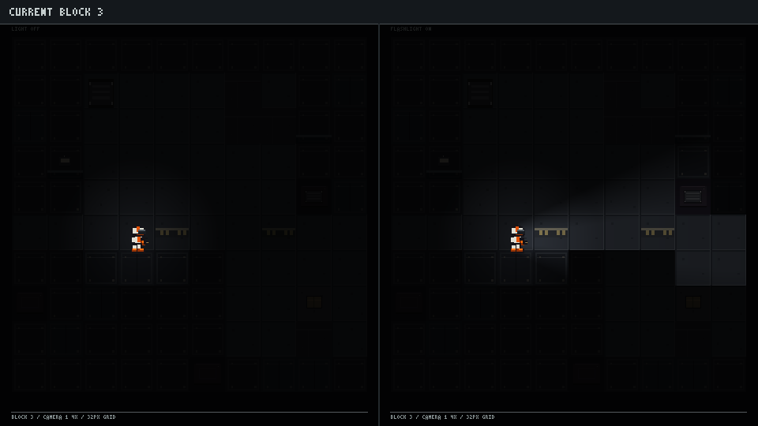
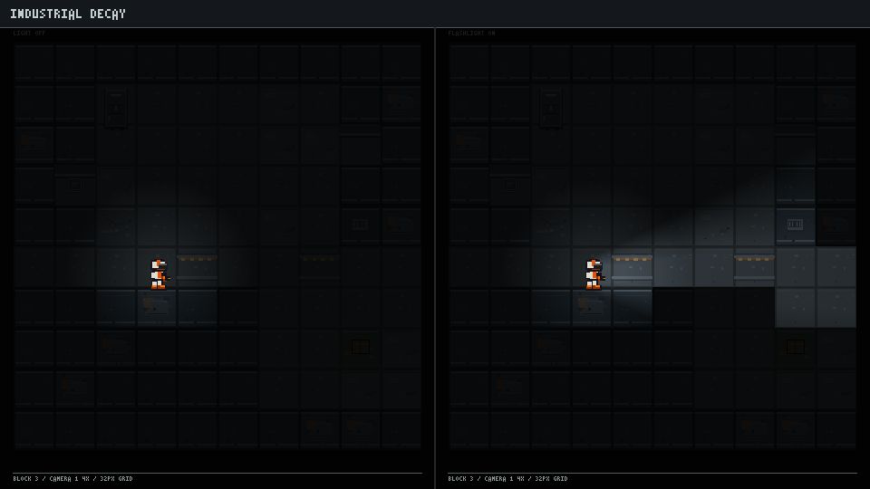
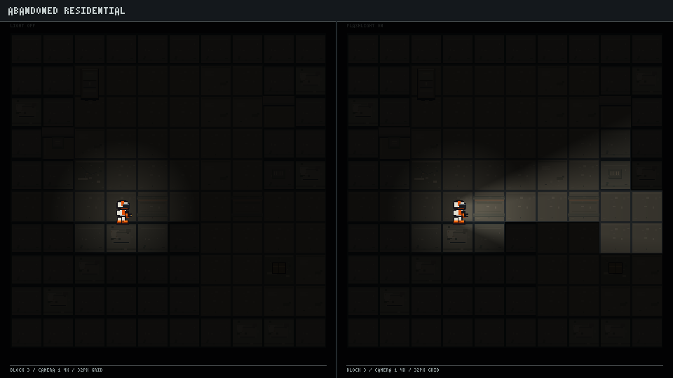
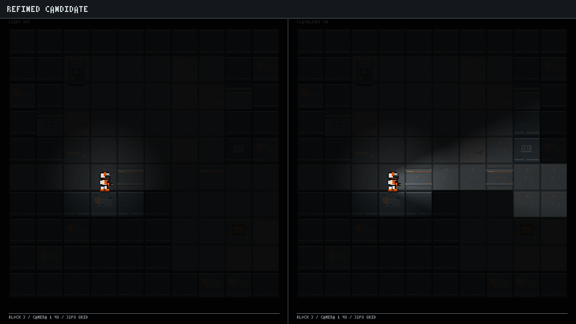

# Block 3 Experimental Visual Redesign

An isolated comparison of the current Block 3 surface treatment with two original art directions and a refined candidate. The experimental textures stay outside `src/` and `public/`; the Vite development build can load the refined set through a temporary in-game switch. Production builds do not copy the experiment textures.

## Renders

Each comparison is 960×540. Left/right panels show the same fixed room/corridor/door/container layout with the light off and on. Tiles render at approximately 1.4× (45 px per 32 px tile), use the authored production player sprite, and are nearest-neighbor enlarged. The compositor applies a dark ambient pass and a directional flashlight cone with tile-based occlusion.

These are inspected, standalone pixel-rendered comparison frames—not screenshots from the running Phaser scene. The test map is a fixed representative layout rather than a captured procedural map/seed. Actual Phaser screenshots are documented separately below.

### Current Block 3



### Variant A — Industrial Decay



### Variant B — Abandoned Residential



### Refined candidate



## Directions and recommendation

**Current weaknesses:** the existing Block 3 relies on shared ordinary-floor concrete and steel wall tiles, then adds sparse peel/crack marks. The material language is serviceable but surface identity is slight; large areas read as a dark generic corridor, and the detail hierarchy is not strong enough to make Block 3 feel specifically neglected.

**A — Industrial Decay:** cold concrete slabs, steel-blue wall panels, rusted trim, restrained yellow utility marks, and compact service fixtures. It is the clearest and most legible direction under the flashlight. It also gives Block 3 a strong mechanical identity; too many exposed pipes or warning stripes would move it toward Block 2.

**B — Abandoned Residential:** worn warm-gray flooring, tired olive/beige plaster, old painted trim, water marks, and room-history details. It feels lonely and human, but currently has weaker material separation in the dark and risks making the setting look like a generic apartment/hospital corridor.

**Refinement:** retain A's steel/concrete structure, reduce rust and safety-yellow frequency, and borrow only small domestic traces from B (faded room cues and quiet staining). Keep them low contrast and sparse so Block 3 remains a neglected version of the same building rather than a different building. The refined option is the best direction to carry into a real Phaser preview; A is the stronger pure material study, while B is a useful source of selective storytelling details.

| Criterion | Current | A: Industrial | B: Residential | Refined |
|---|---|---|---|---|
| Visual cohesion | Medium | High | Medium | High |
| Material quality / floor identity | Low-medium | High | Medium | High |
| Environmental storytelling | Low | Medium | High | Medium-high |
| Readability in this darkness preview | Low | Medium-high | Medium | Medium-high |
| Pixel-art scale consistency | Medium | High | High | High |
| Repetition risk | Medium | Low-medium | Low-medium | Low-medium |
| Fit in 4→3→2→1→13 progression | Generic | Good if restrained | Distinct but too residential | Best |

This is a qualitative art-direction judgment on the displayed comparison images, not a measured performance benchmark. The tile art is deliberately restrained; adding noise or more props would not improve the hierarchy.

## Contents

- `assets/industrial_decay/`: Variant A, 10 PNGs
- `assets/abandoned_residential/`: Variant B, 10 PNGs
- `assets/refined_candidate/`: the revised candidate, 15 PNGs
- `previews/`: four 960×540 comparison images
- `references/`: generated mood boards, kept as references only
- `generate.mjs`: deterministic pixel-grid asset author and comparison renderer
- `design-notes.md`: specific texture and integration notes

## Rebuild the isolated assets and previews

From repository root, run:

```powershell
node art-experiments/block3-redesign/generate.mjs
```

No package install or production manifest change is needed. Do not copy these prototype textures into production until a direction is approved and validated inside the Phaser scene.

## Development-only in-game A/B

Run the normal local dev server (`npm run dev`), start a local run, and reach Block 3 by playing through Block 4. The scene defaults to **Original**. Press **F8** to switch between **Original** and **Refined**; the mode is also shown in the lower-left control hint. The switch recomposes only Block 3's static environment CanvasTexture. It does not restart the scene, move actors, or call the simulation, map-generation, or RNG code. Flashlight and darkness remain runtime layers. The hot-rebuilt canvas and image are reused so the camera filters and display-list order remain stable across repeated switches.

The refined files are queued by `BootScene` only when `import.meta.env.DEV` is true and remain under this experiment directory, outside `public/`. The production build keeps the original Block 3 rendering and does not emit the experimental PNGs. No A/B control is bound on other floors.

The 2026-10-12 controlled-deterioration revision adds two floor-wear grades, localized wall staining, an old repair patch, and a faded doorway notice. It changes only the Refined Candidate's experimental composition; F8 still defaults to Original, and the other experimental art directions remain intact. Placement uses stable coordinates and current tile geometry, protects interactable cells, and adds no simulation/RNG activity. See [`refinement-notes.md`](refinement-notes.md) for the detailed critique, wear weights, new Phaser pair, and remaining validation limits.

To regenerate only the revised candidate assets without replacing the other variants or preview history, run:

```powershell
node art-experiments/block3-redesign/generate.mjs --refined-only
```

### Actual Phaser captures

These are screenshots from the real Phaser canvas at the same local Block 3 run/map and camera position for each pair. The `fullroom` pair is 960×540. The in-app screenshot provider returned 959×540 for the earlier `corridor` captures; they are preserved at their captured dimensions. The wide camera view shows several room, corridor, wall, and threshold contexts at once. The four light-state captures include the runtime `LIGHT` HUD state; flashlight influence is subtle at this overview scale.

- `captures/block3_fullroom_lightoff_original.jpg`
- `captures/block3_fullroom_lightoff_refined.jpg`
- `captures/block3_corridor_lightoff_original.jpg`
- `captures/block3_corridor_lightoff_refined.jpg`
- `captures/block3_corridor_lighton_original.jpg`
- `captures/block3_corridor_lighton_refined.jpg`
- `captures/block3_refinement_overview_original.png`
- `captures/block3_refinement_overview_revised.png`

See [`in-game-comparison.md`](in-game-comparison.md) for findings, limitations, and the production approval checklist.

## Production integration path after approval

1. Review the refined set in the actual Phaser renderer against Block 4 and Block 2, including both flashlight states and generated layouts.
2. Adjust native tile clusters and overlay frequency based on the actual lightmap/occlusion output.
3. Move only the approved final files to the Block 3 environment asset directory and register them through `environmentAssets.ts` / `BootScene`.
4. Add deterministic coordinate-only selection and preserve collision, simulation, and RNG behavior.
5. Add focused manifest/placement regression coverage, then run the project test suite and production build.

The current wiring is development-only. The refined textures have not been permanently enabled or approved for production.
