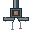
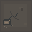
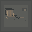

# Block 2, Block 1, and Block 13 production environment art

Authored 2026-10-12 for the existing 32×32 tile grid. The PNGs are original pixel-cluster drawings written by the local generator in this directory. They use no imported or third-party art. Run `node art-production/environment/block2-1-13/generate.mjs` from the repository root to reproduce all twenty files exactly, including the 24×32 breaker fixture and 64×64 exit frame.

## Art direction and use

- **Block 2 — failing infrastructure:** graphite service grating and a compact distribution manifold join the existing sparse warning language. At most two existing panel fixtures per generated map become damaged panels paired with nearby cable junctions and water staining. Yellow remains limited to hardware cues.
- **Block 1 — abandoned structure:** spalled concrete and exposed lath establish material loss. One deterministic, door-adjacent cluster adds a bag, a failed repair, and a departure notice on safe floor/wall cells, clear of objectives, passages, and existing notices.
- **Block 13 — folded architecture:** inset line loops interrupt floor perspective; shifted nested planes remain on solid wall cells; echo symbols and displaced thresholds layer architectural repetition. Sparse repeater panels and a 64×64 interrupted frame at the actual final exit extend those motifs while leaving the real stairs visible.

All assets are registered through the existing BootScene manifests and composed in the existing static map layer with nearest-neighbor sampling. Ordinary placement ranks only existing doors, walkability, protected cells, and stable coordinate hashes; Block 13 selection uses its existing coordinate hash. The final-exit frame is centered on the existing exit and uses transparent pixels around the existing stairs. No simulation state, gameplay RNG, geometry, collision, or lighting rules are involved.

## Asset preview

The images below are native-resolution assets, not gameplay screenshots.

### Block 2

### Block 1

### Block 13

## Rejected candidates and limits

No candidates were rejected. Native-resolution previews, focused asset tests, and static renderer inspection validate dimensions, transparency, deterministic placement, and manifest wiring. A live gameplay review under runtime flashlight/darkness remains unverified in this pass; visual readability under the actual lightmap is the remaining limitation.
